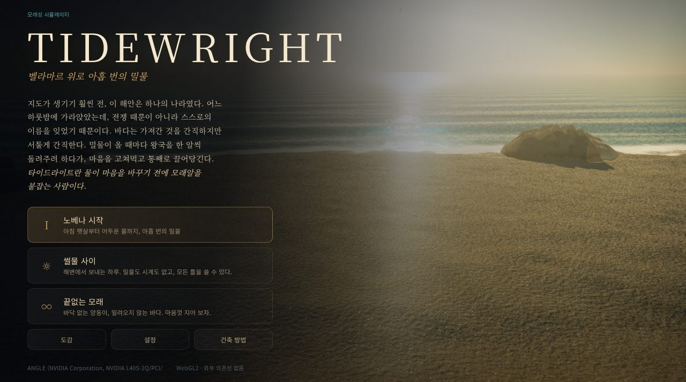
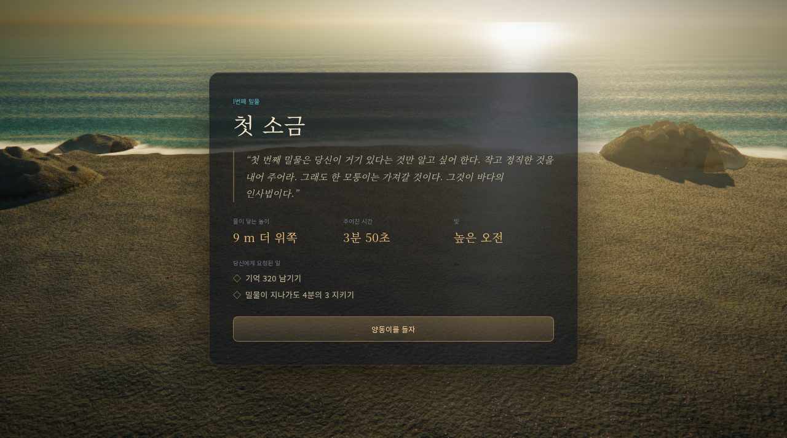
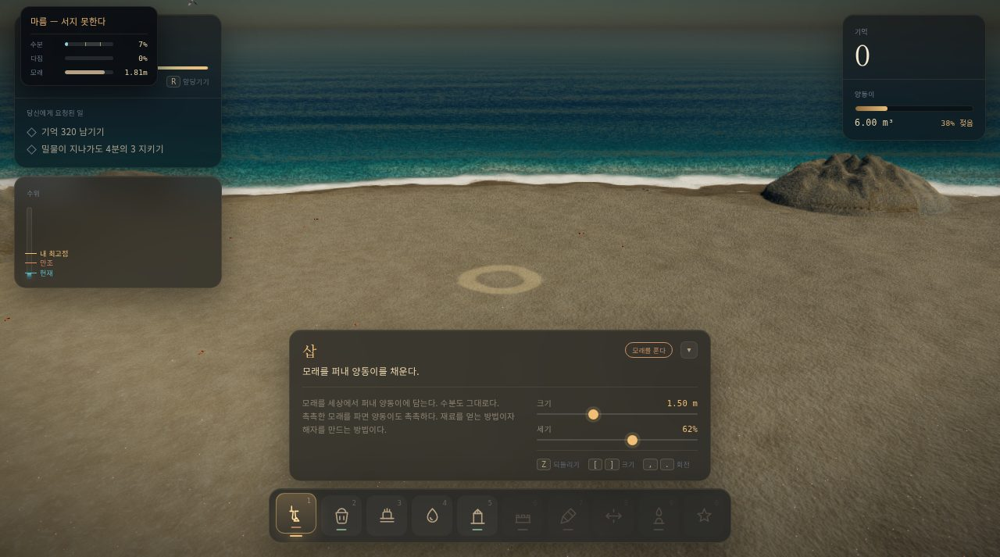

# TIDEWRIGHT (타이드라이트) - 한국어판

> 이 저장소는 [winchxyz/tidewright](https://github.com/winchxyz/tidewright)를 포크해 **게임 화면의 텍스트를 한국어로 옮긴 한글화 버전**입니다.
> 원작의 코드와 식별자(ID), 저작자 표기는 그대로 두고 화면에 보이는 문장만 번역했습니다. 원문 README는 [README.en.md](README.en.md)에 있습니다.

**[브라우저에서 바로 플레이하기](https://sigco3111.github.io/tidewright/)**


## 게임 소개

TIDEWRIGHT는 GPU에서 전부 계산하는 3D 모래성 시뮬레이터입니다. 엔진, 라이브러리, 에셋 파일, 빌드 과정이 없고, 하나의 WebGL2 컨텍스트와 약 7,000줄의 JavaScript/GLSL로 만들어졌습니다. 모래는 안식각 법칙을 실제로 따릅니다.

- 마른 모래는 서지 못하고, 촉촉한 모래는 서며, 너무 젖으면 흘러내립니다. 다지면 더 단단해집니다.
- 모래의 양은 보존됩니다. 파면 양동이가 차고, 쏟으면 비워집니다.
- 파도는 밑동부터 갉아먹고, 해자와 방파제로 힘을 줄일 수 있습니다.
- 아홉 번의 밀물을 견디는 캠페인 "노베나", 시간제한 없는 "썰물 사이", 끝없는 모래의 "끝없는 모래" 모드가 있습니다.
- 아홉 가지 화면 분위기(룩), 사진 모드, 도감(로어)이 있습니다.

## 스크린샷

| 메인 메뉴 | 첫 번째 밀물 브리핑 | 플레이 화면 |
| --- | --- | --- |
|  |  |  |

위 화면은 GitHub Pages에 배포된 한국어판을 실제로 실행해 촬영한 것입니다.

## 조작법

| 입력 | 동작 |
| --- | --- |
| 마우스 왼쪽 | 도구 사용 |
| 오른쪽 / 가운데 드래그 | 회전 / 이동 |
| 휠 | 확대/축소 |
| W A S D · Q E | 이동 · 회전 |
| 1 - 9, 0 | 도구 선택 |
| [ ] | 브러시 반경 |
| Shift | 정밀 조작 |
| Z | 직전 작업 되돌리기 |
| R | 밀물 앞당기기 |
| P | 사진 모드 |
| H | 인터페이스 숨기기 |
| Esc | 일시정지 |

## 한글화 내용

- 로딩/메뉴/HUD/브리핑/결과/설정/건축 방법/일시정지/사진 모드 화면
- 도구, 장식, 틀 이름과 설명, 아홉 밀물의 이름, 시구, 목표 문구
- 도감 문서 11편, 화면 분위기 이름, 하루의 시간대, 평가 문구, 안내 토스트와 커서 옆 상태 문구
- 한글 가독성을 위해 Noto Serif KR / Noto Sans KR 웹폰트를 쓰고, 넓은 자간과 대문자 변환을 줄였습니다 (`css/ui.css` 끝부분).
- 내부 ID, 저장 데이터 키, 시뮬레이션 로직은 바꾸지 않았습니다.

## 알려진 한계

- 모든 밀물과 도감 문서를 끝까지 플레이해 확인하지는 못했습니다. 메뉴, 브리핑, 첫 밀물 HUD는 실제 화면으로 확인했습니다.
- 마우스와 키보드 중심 게임이라 모바일 터치 조작은 확인하지 못했습니다.
- 부동소수점 렌더 타깃을 지원하는 WebGL2가 필요하며 저사양 GPU에서는 설정에서 품질을 낮추세요.
- 원문 README(`README.en.md`)의 상세 기술 설명은 번역하지 않았습니다.

## 직접 실행하기

```sh
node server.js
```

`http://localhost:5173`에서 열립니다. 빌드 과정은 없습니다.

## 배포

`.github/workflows/pages-ko.yml`이 정적 파일을 GitHub Pages에 배포합니다. Settings → Pages의 소스는 **GitHub Actions**여야 합니다.

## 라이선스와 출처

원작은 [winchxyz/tidewright](https://github.com/winchxyz/tidewright)이며 MIT 라이선스로 공개되어 있습니다. 이 한글화 저장소도 같은 라이선스([LICENSE](LICENSE))를 따르고 원 저작권 표기를 유지합니다.
